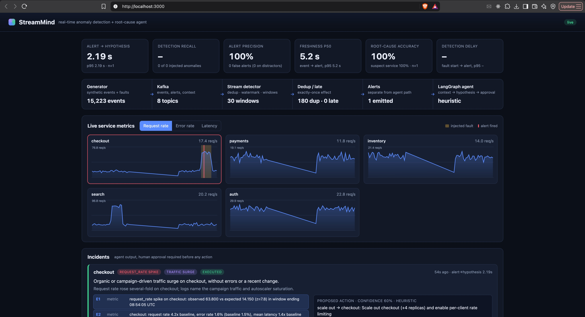
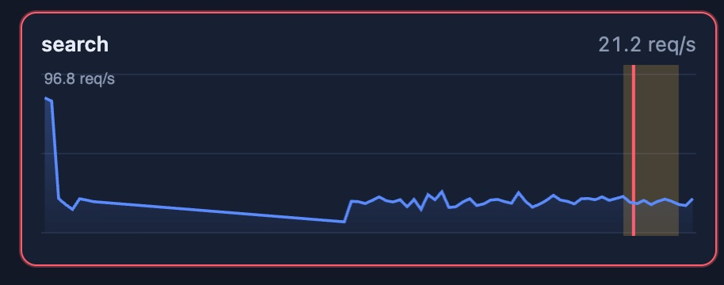
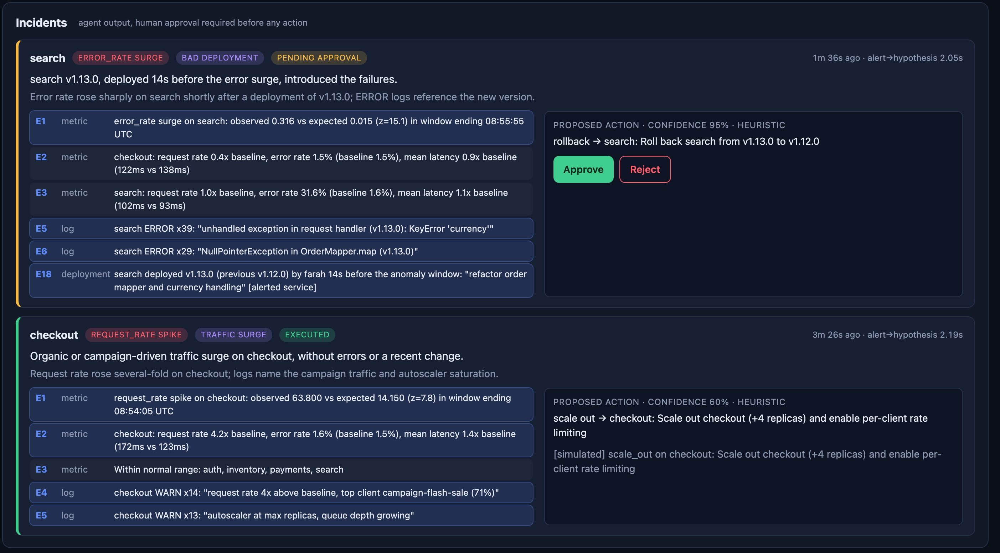
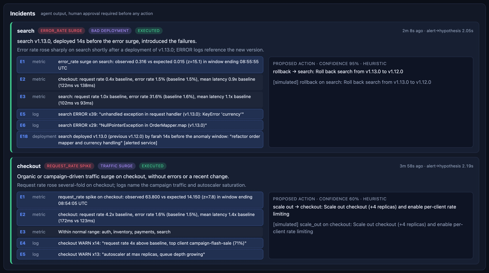
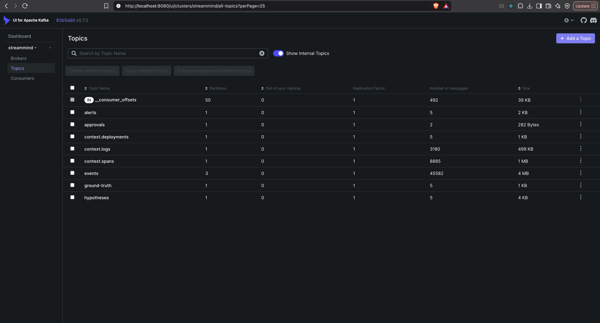
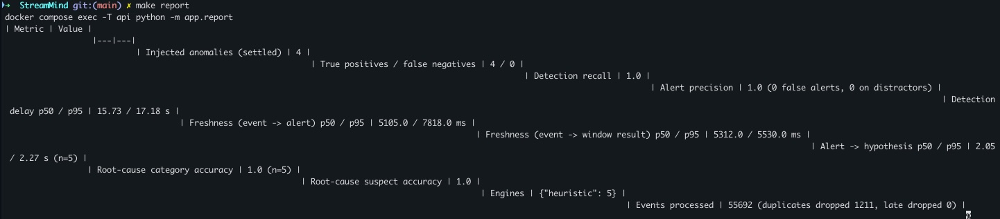

# StreamMind

Real-time + AI combined: a Kafka streaming pipeline detects anomalies in seconds and hands them to a LangGraph agent that retrieves logs, traces and deployments, proposes a root cause with citations, and waits for human approval before any action.

The streaming path and the agent path are deliberately separate. The LLM never sits inside the stream; the only coupling is the `alerts` topic.

## Quick start

```bash
docker compose up --build
```

Open the dashboard at http://localhost:3000. The generator warms up for about 90 seconds, then injects a fault every 40 to 70 seconds.

Optional: set `ANTHROPIC_API_KEY` (copy `.env.example` to `.env`) to switch the agent from its offline heuristic engine to Claude. Without a key everything still runs.

```bash
docker compose down        # stop
docker compose down -v     # stop and wipe Kafka and ClickHouse data
make report                # print the benchmark table from the running stack
```

## How it works

```
generator ──► Kafka[events] ──► detector ──► Kafka[alerts] ──► agent (LangGraph) ──► Redis ──► API ──► dashboard
    │                              │                               │                  ▲
    └─► Kafka[context.*] ─► sink ─► ClickHouse ◄───────────────────┘ (retrieval)      │
    └─► Kafka[ground-truth] ───────────────────────────────────────────────────────────┘ (scoring only)
```

1. **Generator** emits request events for five services with a dependency graph, plus logs, trace spans and deployments. It injects labelled faults: bad deployment, dependency degradation, traffic surge, upstream outage, and distractors (duplicate bursts, late and out-of-order data). Ground truth goes to a separate topic that only the scorer reads.
2. **Detector** deduplicates by event id, assigns event-time tumbling windows (5 s), advances a watermark with 5 s allowed lateness, drops too-late events, and scores each window against an EWMA baseline. An alert needs two consecutive anomalous windows, so single noisy windows do not page anyone. Alerts go to Kafka; window aggregates go to ClickHouse.
3. **Agent** (LangGraph) consumes alerts and runs: `gather_context` (ClickHouse logs, spans, deployments, cross-service metric deltas) → `hypothesize` (Claude with structured output, or the offline heuristic engine) → `validate` (every citation must resolve to real evidence, otherwise retry) → `publish` → `approval` (graph `interrupt`) → `execute`. Alerts for a service with an open incident are merged into it.
4. **Human approval**: the dashboard or `POST /api/incidents/{id}/approve|reject` publishes to Kafka; the agent resumes the paused graph. Execution is simulated and audited.
5. **API + dashboard** serve live series, incidents, evidence and the benchmark.

Design notes are in [docs/architecture.md](docs/architecture.md).

## Services

| Service | Port | Image / stack | Role |
|---|---|---|---|
| dashboard | 3000 | nginx:alpine | Live charts, incidents, approvals, KPIs |
| api | 8000 | python:3.11-slim, FastAPI | REST API, ground-truth scoring, `/api/metrics` |
| kafka-ui | 8080 | provectuslabs/kafka-ui | Inspect topics and messages |
| clickhouse | 8123 | clickhouse-server | Window metrics, logs, spans, deployments |
| redis | 6379 | redis:7-alpine | Dedup state, alerts, incidents, counters |
| kafka | internal | apache/kafka (KRaft) | Event bus |
| kafka-init | n/a | apache/kafka | Creates topics, exits |
| generator | n/a | python:3.11-slim | Synthetic traffic and fault injection |
| detector | n/a | python:3.11-slim | Streaming detection |
| sink | n/a | python:3.11-slim | Context topics into ClickHouse |
| agent | n/a | python:3.11-slim, LangGraph | Root-cause agent |

## Benchmark

Measured by the system itself against injected ground truth. Run `make report` on a running stack to reproduce.

| Metric | How it is measured |
|---|---|
| Alert → hypothesis | `hypothesis_at − detected_at` per incident, p50/p95 |
| Detection recall / precision | Alerts matched to injected anomalies by service and time window; alerts matching none are false positives |
| Detection delay | Fault start to first matching alert |
| Freshness | Latest event time in the triggering window to alert time, p50/p95 (also per closed window) |
| Root-cause accuracy | Hypothesis category and suspect service vs. the injected cause |

Results from the run in the screenshots (heuristic engine, 4 settled anomalies, so indicative only): recall 1.0 (4 of 4), precision 1.0, detection delay p50 15.7 s / p95 17.2 s, event-to-alert freshness p50 5.1 s / p95 7.8 s, alert → hypothesis p50 2.05 s / p95 2.27 s, root-cause category and suspect accuracy 100% (n=5). 1,211 duplicate events were dropped by dedup with no false alerts. Run longer, and with `ANTHROPIC_API_KEY` set, for numbers you can quote; alert → hypothesis will be higher with an LLM.

## Project structure

```
.
├── docker-compose.yml
├── Makefile
├── .env.example
├── clickhouse/    Dockerfile, init.sql (schemas, TTLs)
├── generator/     topology, fault injection, event/log/span/deploy producers
├── detector/      dedup, event-time windows, watermark, EWMA rules, alert publisher
├── sink/          context topics to ClickHouse
├── agent/         LangGraph graph, evidence retrieval, heuristic and LLM engines, approval
├── api/           FastAPI, scoring (metrics.py), report.py
├── dashboard/     static UI served by nginx, proxies /api
└── docs/          architecture notes
```

## Notes on the stack

The brief names Flink or Spark Structured Streaming. The detector instead implements the same semantics (event-time windows, watermarks, allowed lateness, dedup) in plain Python on the Kafka consumer API. That keeps `docker compose up --build` fast and dependency-free at this event rate (about 85 events/s); swapping in Flink would mean reimplementing `detector/app/main.py` against the same `events` and `alerts` topics.

## Screenshots

| | |
|---|---|
|  |  |
|  |  |
|  |  |
